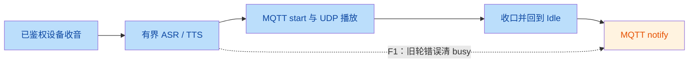
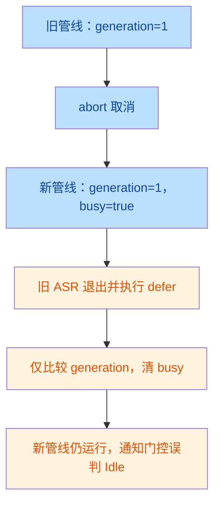

# Homevoice M0 独立验收报告

日期：2026-10-22

## 判定

**候选离线验收：不通过，修复后复验。M0 总体：阻塞，未完成。**

原有自动化检查全部通过，但补充回归稳定复现四项缺陷。每项均由两名独立验证 Agent 读取源码与必要调用上下文后确认。二审为静态复核，不等于额外两次测试执行。

此次仅执行隔离离线测试，没有修改候选代码、提交、推送、合并 PR、访问真实云服务、操作真实设备或 Home Assistant。

## 固定范围

| 项目 | 值 |
|---|---|
| 仓库 | `/Users/kevin/Documents/works/homevoice` |
| PR | https://github.com/kevin4044/homevoice/pull/1 |
| 分支 | `feature/m0-transport-probe` |
| 固定 HEAD | `4152a4c2143447e639d282f1bcc53a9d0faf147c` |
| 比较范围 | `main...HEAD`，110 文件、23498 行新增、9 行删除 |
| 本地一致性 | PR head 与本地 HEAD 一致；验收前后工作区均干净 |
| 验收依据 | 新仓库 `docs/milestones/M0-transport-probe/` 的 M0-v0.1 规格、协议与验收矩阵 |
| 批准边界 | 按 PR 披露的离线实现授权验收；文档仍标记待批准，不因此扩大真实操作授权 |

实现意图：通过隔离探针验证可信 MQTT 身份、UDP/Opus、播放与通知生命周期、设备 MCP 及当前设备工具绑定，为后续真实兼容性验证提供底座。不是生产服务，也不是完整 M0 已完成证明。

## 已确认缺陷

P1 表示应优先修复的行为或安全边界问题；P2 表示必须修复的功能或协议兼容性问题。该排序不代表已证实公网攻击或真实设备执行。

| 编号 | 问题 | 修复建议 | 源码位置 |
|---|---|---|---|
| F1 / P1 | 旧管线退出会清掉同连接代次的新轮忙碌状态 | 使用每轮独立 token；调度前固定会话和 cancel，退出仅清当前轮状态 | [probe.go:885–889](file:///Users/kevin/Documents/works/homevoice/internal/m0/probe/probe.go#L885-L889) |
| F2 / P1 | 已取消的工具调用仍发布具有副作用的请求 | 入口及发送前检查取消；发送接口支持 context 和有界退出 | [devicemcp.go:593–603](file:///Users/kevin/Documents/works/homevoice/internal/m0/devicemcp/devicemcp.go#L593-L603) |
| F3 / P2 | SSE 收到完整匹配响应后仍等待 EOF，最终误报超时 | SSE 增量解析；匹配 result/error 即完成，保留大小、事件数和期限限制 | [transport.go:107–109](file:///Users/kevin/Documents/works/homevoice/internal/m0/remotemcp/transport.go#L107-L109) |
| F4 / P2 | 音量绑定遗漏额外 required 和 enum 约束 | 明确支持的 schema 子集；无法正确映射的约束拒绝暴露或完整支持 | [loop.go:501–518](file:///Users/kevin/Documents/works/homevoice/internal/m0/agent/loop.go#L501-L518) |

### F1：语音轮次所有权

连接 generation 不随同一连接内的语音轮次变化。旧轮已进入 ASR，被取消后，新轮开始 ASR；旧轮稍后退出，defer 仅比较 generation，直接清除 `pipelineBusy`。

此时新轮既不收音也不播放，`isBusy` 返回 false，在线设备通知会被放行，违背 R07/R08 和 A20。`Stats.PendingTasks` 也会低报尚在执行的管线。补充测试证明 busy 被清；通知影响由实际 gating 路径确认，没有声称测试观察到真机通知。

另应一并检查 [probe.go:894–900](file:///Users/kevin/Documents/works/homevoice/internal/m0/probe/probe.go#L894-L900)：会话和 cancel 到 goroutine 启动后才读取、登记。修复应在调度前锁内建立轮次所有权，而不是只给 defer 添加 session 比较。

复验门槛：旧轮取消后延迟退出，新轮仍在 ASR/TTS 时 Busy 必须为 true，notify 必须返回 busy；旧完成不能清新轮状态或覆盖取消句柄。同一 session 与重 HELLO 场景都要覆盖。

### F2：取消没有阻止发布

已取消的 context 进入有效 `CallTool` 时，仍先执行 `SendMCP`，之后才监听 `ctx.Done()`。复现观测到一次 `tools/call` 发送；返回取消错误无法撤回已经发布的命令。

这证明取消后仍发送，不证明真实设备已经执行。涉及 R09/A25。同步 sender 也不能仅靠预先注册 timer 被中断，不能把请求等待超时当作发送阶段已有期限。

复验门槛：预取消的有效工具请求发送计数必须为零；受控阻塞 sender 必须能在期限或取消后退出。明确发送后的取消与执行结果不确定性，不能自动重试副作用操作。

### F3：SSE 消费依赖连接结束

TLS 模拟服务器发送带空行终止、ID 匹配的完整 JSON-RPC SSE 事件并 flush，随后保持流开启。客户端在 `ReadAll` 中等待 EOF，到 200 ms 的测试期限后返回 `ErrTimeout`，没有消费已完整收到的响应。

200 ms 只用于加速复现，增大期限不解决依赖 EOF 的问题。立即关闭流的端点不受影响。既有 SSE 测试为有限响应，不覆盖持流场景。涉及 R11/A26/L03。

复验门槛：保持流开启时，完整匹配事件仍及时完成；错误响应及时失败；半包、无匹配 ID、超限、取消与超时仍有界。

### F4：schema 被放宽

以下两个有效 schema 均被接受为 `volume: 0..100` 的绑定：

- `required: ["volume", "zone"]`，其中 zone 是额外必填字段；执行器实际只发送 volume。
- volume 有 `enum: [0, 50, 100]`；合成工具却允许范围内的其他整数，例如 20。

参数构造路径见 [executor.go:52–60](file:///Users/kevin/Documents/works/homevoice/internal/m0/agent/executor.go#L52-L60)。设备端拒绝不合法参数不能替代本地校验。该问题不证明模型获得跨设备目标选择权，也不证明服务端虚报执行成功。涉及 A23/R10/A24。

复验门槛：额外 required 无法映射时不得暴露；enum 应被正确映射并校验，或整项拒绝。增加合法 optional 字段正例，避免过度拒绝。

## 执行证据

环境：macOS darwin/arm64、Go 1.27.1、CGO=1、libopus 1.6.1。复用已存在的模块缓存，`GOPROXY=off`，不下载依赖。

最终完整入口：

```bash
GIT_OPTIONAL_LOCKS=0 make verify-m0 \
  CACHE=/tmp/homevoice-m0-review.dMypdU/cache \
  EVIDENCE=/tmp/homevoice-m0-review.dMypdU \
  GOMODCACHE=/Users/kevin/Documents/works/homevoice/.cache/gopath/pkg/mod \
  GOPROXY=off
```

结果：exit 0；gofmt、go vet、race 测试、报告生成和候选快照完成。19 个测试包通过，317 条测试及子测试通过事件，0 失败。自动报告中 A01–A28 均为 PASS。

先前尝试受到仓库缓存写权限及可选 Git index.lock 的沙箱限制；临时缓存和禁用 Git 可选锁解决了限制，不是产品测试失败。

补充回归使用 `git archive HEAD` 创建隔离副本，仅在副本内新增测试。候选源码未改：

| 测试 | 实际结果 |
|---|---|
| `TestRefereeOldPipelineMustNotClearNewBusy` | FAIL：新轮仍在 ASR，旧取消管线清掉 busy |
| `TestRefereeCanceledToolMustNotBeSent` | FAIL：预取消后仍发送 1 次工具请求 |
| `TestRefereeSSEMustCompleteBeforeEOF` | FAIL：完整 SSE 已 flush，仍超时 |
| `TestRefereeUnsupportedSchemaMustNotBind/extra-required-target` | FAIL：额外必填字段被忽略，绑定成功 |
| `TestRefereeUnsupportedSchemaMustNotBind/restricted-enum` | FAIL：离散约束被放宽，绑定成功 |

先运行 `go test -race -count=1 -run TestReferee`，再运行 `-count=3`；全部反例每次均复现，没有数据 race 报告。这些 FAIL 是期望正确行为的测试揭示候选缺陷，不是新测试已通过。

临时复现源码位置：`/tmp/homevoice-m0-review.dMypdU/repro/internal/m0/{probe,devicemcp,remotemcp,agent}/referee_review_test.go`。缓存、原始测试日志及调试副本保留在临时位置，不属于候选交付。

因此自动矩阵 PASS 不能替代裁判结论：A20 的轮次隔离、A25 的取消前发送、A26 的持流响应、A23/A24 的 schema 子集仍需补足。

## 未完成与安全限制

| 范围 | 状态与原因 |
|---|---|
| L01–L03 | 未执行；没有真实供应商、端点、费用预算及操作授权 |
| H01–H06 | 未执行；没有目标设备、固件、隔离网络及设备操作授权 |
| live/hardware 入口 | 实际验证流程未实现；即便提供配置仍返回 BLOCKED，并非只差配置 |
| 固件兼容性 | MQTT TLS、配置写入/恢复、双向真实语音、Idle notify、真实 MCP 能力仍未验证 |
| 公网安全 | UDP CTR 无认证标签、首包 peer 抢占、双向 counter 复用/重叠仍需明确补救方案和批准 |

流程缺口源码：[verify/live.go:16–30](file:///Users/kevin/Documents/works/homevoice/internal/m0/verify/live.go#L16-L30) 与 [36–47](file:///Users/kevin/Documents/works/homevoice/internal/m0/verify/live.go#L36-L47)。PR 已明确披露此范围，不把它当作作者声称已完成；但也不能因此认定整体 M0 通过。

合成测试、MQTT publish 成功、UDP 解密成功均不能替代真实播放观察或安全认证。本报告不授予公网部署、OTA、HA 写操作或真实设备写操作权限。

## 流程摘要

业务路径：



关键技术竞争：



## 下一轮交付要求

将 F1–F4 交回编码负责人，保留原验收门槛，不通过删除测试或放宽定义来通过。

修复候选应带四类回归及关键集成测试；重新运行完整离线入口，提交固定新 HEAD 和脱敏证据，再由裁判复验。不能复用本报告作为修复版通过证明。

真实云与硬件流程的补实现和执行，需分别确认范围、配置、费用、网络、设备及操作授权。离线修复后可重新判定离线候选，但 M0 总体仍需满足规格中的真实验证与安全决策条件。
